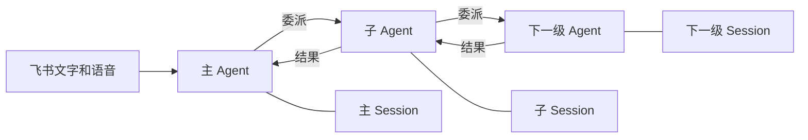

# Agent 模型与角色配置设计

## 背景与目标

- 当前飞书路由用 Session ID 接收用户输入。委派工具返回 `child_session_id`，后续任务用它继续原子会话。Session 同时承担了对外可操作的身份和内部历史、调度两项职责。
- 当前子会话使用固定角色指令，没有工具。主、子会话组装模型请求时还会读取同一份启动目录下的 `AGENTS.md`，很难给调研、审阅等角色配置不同指令与工具。
- 改造后，用户输入进入主 Agent，委派指向子 Agent。每个 Agent 绑定自己的 Session。角色配置由独立文件提供，运行时按绑定角色加载指令和工具。可复用现有历史、工具续轮和异步回投机制。 [会话调度器重构方案](<../0003-会话调度器重构方案/规划调度器重构方案.md>) · [现有运行时说明](../../../README.md#运行时边界)

## 已确定的关键取舍

- **Agent 是操作对象。** 子 Agent 有可复用的 ID，Session 留在内部。一个 Agent 绑定一个 Session。同一个 Agent 可以执行多次任务，共用其 Session 历史。
- **各层 Agent 共用工具机制。** 子 Agent 可以执行其角色允许的工具，也可以继续创建或复用自己的直属子 Agent。是否开放委派由角色工具白名单决定。
- **一角色一文件。** 使用启动目录下的 `agents/`。文件头是由 `+++` 包围的 TOML，后面的 Markdown 正文原样作为系统提示词。文件名去掉 `.md` 后同时作为角色名和角色 ID，`main.md` 定义主角色。
- **按 Agent 串行，按不同 Agent 并行。** 移除旧分派器的两个并发位和每个主会话八个在途任务的固定受理上限。本期不新增任务数、委派深度或并发限制。
- **运行轮次独立计数。** 保留 `runtime.max_tool_rounds`，默认 `8`，含首轮。它限制单次运行的模型请求次数。运行中纳入输入不重置计数；开始新运行才重新计数。 [现有配置](../../../config.example.toml)

## Agent、Session、委派和运行

| 对象 | 身份与归属 | 职责 |
| --- | --- | --- |
| Agent | `agent_id`、`role_id`、`session_id`、可选的 `parent_agent_id` | 接收用户输入、委派或异步结果，确定角色、工具和直属子 Agent。 |
| Session | `session_id`，与 Agent 一对一 | 保存历史、摘要和模型回放信息，承接输入队列与串行执行。 |
| 委派 | `delegation_id`，记录委派方和目标 Agent、委派方的 `run_id` 与原 `tool_call_id` | 记录一次任务受理。受理时不分配目标运行的 `run_id`。 |
| 运行 | `run_id`，归属一个 Agent，由 Runtime 实际启动运行时生成 | 处理纳入本次运行的输入，维护模型轮次和最终回复。一次运行可纳入多条输入，不与委派一一对应。 |



- Agent 记录持久化到 SQLite。`agent_id` 和 `session_id` 各自唯一，父 Agent 引用已有 Agent。新 Agent 的 ID 独立生成。主 Agent 的 `parent_agent_id` 为空，子 Agent 的归属随创建建立。运行记录关联 Agent 身份，底层历史仍通过 Session 查询。
- 继续使用已经核验的飞书私聊路由定位主 Agent。同一联系人的文字、语音、通话状态和后台回投进入同一个主 Agent。不同联系人的主 Agent 和历史各自独立。主 Agent 的回复走现有语音或文字投递路径。
- 同一 Agent 只有一条 Runtime 输入队列。进程在线时，空闲 Agent 可由新输入或下级回投唤起。使用本版本数据库重启时，复用已持久化的 Agent 和 Session 绑定及历史，按需创建运行时。本期不迁移旧数据库，不兼容旧会话标识或旧回执。

## 委派协议

### 创建与复用

- 工具名沿用 `delegate_subtask`。`prompt` 必填，为非空任务说明。`agent` 和 `agent_id` 对应两种调用方式，必须且只能提供其中一个。
- **创建子 Agent**。传 `agent`，其值从可选子角色中选择。创建独立的 Agent 和 Session，绑定角色及直属父 Agent，并受理本次任务。每次走创建路径都会产生一个新实例，同一角色可以有多个实例。
- **复用子 Agent**。传 `agent_id`，以当前 Agent 为委派方核验直属归属，再沿用目标实例的角色与 Session 历史。角色已经删除或改名时返回明确错误，历史保留。重新提供同名角色文件后可继续使用。
- 错误参数、未知角色、未知实例和非直属实例均在受理前返回工具错误。创建 Agent、绑定 Session 和写入委派受理记录在同一事务中完成。提交成功且任务入队后返回受理标识。提交后若入口已关闭，将委派标记为中断并返回受理失败。

创建审阅 Agent。

```json
{"agent":"review","prompt":"检查方案中的边界条件"}
```

受理时立即返回子 Agent 和本次委派的标识，不等待子 Agent 执行，也不承诺新开一次运行。

```json
{"status":"accepted","agent_id":"agent-example","delegation_id":"delegation-example"}
```

下一次复用这个 Agent。

```json
{"agent_id":"agent-example","prompt":"根据补充信息继续审阅"}
```

### 工具与参数校验

- Agent 的白名单包含委派工具且存在可用子角色时，向模型提供委派工具。`agent` 的 `enum` 使用子角色 ID，工具说明列出对应的 `description`。`main` 保留给主角色。工具处理器校验参数组合、角色和归属，模型工具定义负责提示候选和调用方式。
- 同一份工具白名单控制模型看到的工具定义和运行时可执行的处理器。模型尝试调用白名单外的工具时，运行时返回工具错误。运行中保存可信的 Agent 身份和输入来源，工具处理器以这些信息做归属与调用条件校验。
- 离线测试和开发演示可使用内置角色夹具验证创建、复用和多层委派，调用参数仍按上述规则校验。正式启动不使用内置角色作为回退。

## 多层调度与结果回投

### 输入与运行边界

新任务和异步结果进同一条队列；空闲时开新一轮，运行中在安全边界纳入；子 Agent 每轮的最终回复都交给直属父级。

- 主、子 Agent 共用 Runtime 的输入、工具执行和续轮逻辑。主 Agent 入口沿用用户说话和转写期间的暂存与放行顺序；子 Agent 入口不检查通话状态，直接放行到 Runtime 队列，不抢占正在执行的模型请求。
- 当前运行的工具已结算且还有模型续轮时，已入队的输入可按序纳入历史，沿用本次 `run_id` 和轮次计数。没有续轮时，输入留在队列，由后续运行处理。子 Agent 不因委派下级进入等待状态，也不要求等齐下级结果；晚到的回投可启动新运行，不恢复已结束的运行。本轮结束不等于整个任务结束。
- 轮次用尽时，仍先结算已启动的工具，再以轮次用尽结束当前运行。已受理的下级任务照常执行，结果回来时仍走同一输入路径。

### 委派资格与回复信封

- 角色允许委派时，主 Agent 收到真实用户输入、子 Agent 收到已受理的父级委派，或两者收到可信的下级回投，都可以发起委派。仅收到下级回投也可以继续委派，无需用户或父级再次输入。输入来源由运行时的可信入口确定，不由模型消息角色、正文或工具参数声明。定时器等其他内部事件的授权规则保持不变。
- 原工具调用只有一条工具结果，即受理回执或受理错误。子 Agent 每次运行把最终完整正文作为内部事件交给直属父级；运行失败时同样回投明确错误。工具轮正文留在当前 Agent 的历史里。即使一轮纳入多条输入，也只回投一条最终回复；由晚到结果触发的新运行仍按同一机制回复父级。
- 回复信封携带来源 `agent_id`、来源 `run_id` 和正文或错误。当轮直接纳入父级委派时，信封携带对应的 `delegation_id`；有多条父级委派时带齐。只收到下级回投的新一轮沿用同一个信封和回投机制，不要求追溯此前的父级委派。这些标识用于关联来源和委派，不指定父级在哪次运行处理。重复事件按来源 Agent 和来源运行识别，不按委派 ID 去重，以免丢弃晚到结果触发的新运行回复。

### 执行和故障处理约定

- 保留现有 SQLite 锁冲突的有限重试语义。事务提交失败时返回原工具调用的错误，避免留下半创建的 Agent。运行终态先存储再回投。只重试失败的数据库操作，不重跑已执行的模型或工具，也不重复投递已入队的回复。
- 终态持续无法写入时记录运行诊断，不把未持久化的终态作为正常结果回投。关闭时停止受理和回投，标记仍在排队的委派和未结束的运行中断；异常退出后由下次启动收尾。不自动重跑未完成任务，也不补投未送达的回投。

## 角色文件

从进程启动工作目录下的 `agents/` 加载 UTF-8 编码的顶层 `.md` 角色文件，跳过 `*.example.md`。实际角色的 ID 由文件名决定。

```text
agents/
  main.example.md  # 仓库及部署包提供
  sub.example.md   # 仓库及部署包提供
  main.md          # 本地必需
  review.md        # 本地可选子角色示例
```

- 仓库和部署包只提供两个模板，不提供正式角色文件。计划在 `.gitignore` 中忽略 `/agents/*`，仅放行 `/agents/main.example.md` 和 `/agents/sub.example.md`。
- 正式启动必须有有效的 `agents/main.md`。缺少目录或该文件时停止启动，提示复制 `agents/main.example.md` 为 `agents/main.md` 后配置。需要子角色时，可复制 `agents/sub.example.md` 为 `agents/review.md` 等实际角色文件。只有有效主文件也能启动，没有子角色时不显示委派工具。

`agents/review.md` 示例。

```markdown
+++
description = "适合审阅方案、检查遗漏和边界条件"
tools = []
+++
你负责审阅方案。优先指出影响正确性的问题，并说明各自的触发条件。

---

结果按问题与依据组织。
```

- 首行 `+++` 开始文件头，下一条独占一行的 `+++` 结束文件头。用项目现有的 `tomllib` 解析两条线之间的字段。结束行之后直到文件末尾的内容原样进入该角色的系统提示词，包括空行、Markdown 标题和分隔线。
- YAML 和 TOML 文件头都能保留相同的正文。选 TOML 是为了复用项目现有的配置语法和 Python 自带的解析器。字段与角色指令放在同一个文件，编辑时可以一并核对。
- 子角色填写非空 `description` 供委派选择，主角色可省略描述。每份文件声明 `tools`，使用已静态注册的工具名数组，`[]` 表示该角色没有工具。
- 启动时校验整组实际角色。文件格式错误、未知字段和未知工具名导致启动失败，诊断应能定位文件和出错位置或字段。角色文件修改在重启后生效，已有 Agent 使用绑定角色的最新配置。
- 正式启动直接使用角色文件正文作为角色指令，不读取旧 `AGENTS.md`，也不回退到内置角色。

实施顺序与可检查的验收判据见 [Agent 模型与角色配置实施与验收](<Agent 模型与角色配置实施与验收.md>)。
