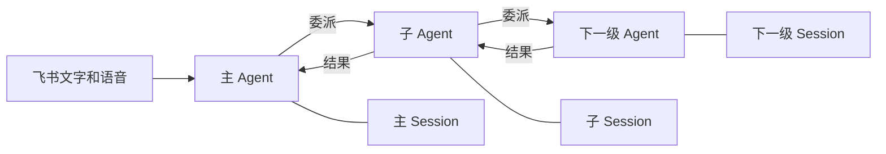

# Agent 模型与角色配置设计

## 背景与目标

- 当前飞书路由用 Session ID 接收用户输入。委派工具返回 `child_session_id`，后续任务用它继续原子会话。Session 同时承担了对外可操作的身份和内部历史、调度两项职责。
- 当前子会话使用固定角色指令，没有工具。主、子会话组装模型请求时还会读取同一份启动目录下的 `AGENTS.md`，很难给调研、审阅等角色配置不同指令与工具。
- 改造后，用户输入进入主 Agent，委派指向子 Agent。每个 Agent 绑定自己的 Session。角色配置由独立文件提供，运行时按绑定角色加载指令和工具。可复用现有历史、工具续轮和异步回投机制。 [会话调度器重构方案](<../0003-会话调度器重构方案/规划调度器重构方案.md>) · [现有运行时说明](../../../README.md#运行时边界)

## 已确定的关键取舍

- **Agent 是操作对象。** 子 Agent 有可复用的 ID，Session 留在内部。一个 Agent 绑定一个 Session。同一个 Agent 可以执行多次任务，共用其 Session 历史。
- **各层 Agent 共用工具机制。** 子 Agent 可以执行其角色允许的工具，也可以继续创建或复用自己的直属子 Agent。是否开放委派由角色工具白名单决定。
- **一角色一文件。** 默认使用启动目录下的 `agents/`。文件头是由 `+++` 包围的 TOML，后面的 Markdown 正文原样作为系统提示词。文件名去掉 `.md` 后同时作为角色名和角色 ID，`main.md` 定义主角色。
- **按 Agent 串行，按不同 Agent 并行。** 取消现有的每个主会话同时最多执行两个子任务的限制。整条委派链的子任务总数无预算上限。
- **运行轮次独立计数。** 保留 `runtime.max_tool_rounds`，默认 `8`，含首轮。它限制单个 Agent 的单次运行，父子 Agent 的运行各自计数。等待子结果后续跑原运行时，接着原计数。 [现有配置](../../../config.example.toml)

## Agent、Session 和运行

| 对象 | 身份与归属 | 职责 |
| --- | --- | --- |
| Agent | `agent_id`、`role_id`、`session_id`、可选的 `parent_agent_id` | 接收用户输入或委派，确定角色、工具和直属子 Agent。 |
| Session | `session_id`，与 Agent 一对一 | 保存历史、摘要和模型回放信息，承接输入队列与串行执行。 |
| 运行 | `run_id`，归属一个 Agent | 执行一次输入或委派，维护本次模型轮次、等待状态和最终结果。子任务运行另外关联委派方的 Agent、运行和原工具调用。 |



- Agent 记录持久化到 SQLite。`agent_id` 和 `session_id` 各自唯一，父 Agent 引用已有 Agent。新 Agent 的 ID 独立生成。主 Agent 的 `parent_agent_id` 为空，子 Agent 的归属随创建建立。运行记录关联 Agent 身份，底层历史仍通过 Session 查询。
- 继续使用已经核验的飞书私聊路由定位主 Agent。同一联系人的文字、语音、通话状态和后台回投进入同一个主 Agent。不同联系人的主 Agent 和历史各自独立。主 Agent 的回复走现有语音或文字投递路径。
- 同一 Agent 只有一条执行队列。闲置后或重启时可按 Agent 记录恢复其 Session，再按需创建运行时。子 Agent 的文本结果通过内部事件返回直接委派者。

## 委派协议

### 创建与复用

- 工具名沿用 `delegate_subtask`。`prompt` 必填，为非空任务说明。`agent` 和 `agent_id` 对应两种调用方式，必须提供其中一个。
- **创建子 Agent**。传 `agent`，其值从可选子角色中选择。创建独立的 Agent 和 Session，绑定角色及直属父 Agent，并受理本次任务。每次走创建路径都会产生一个新实例，同一角色可以有多个实例。
- **复用子 Agent**。传 `agent_id`，以当前 Agent 为委派方核验直属归属，再沿用目标实例的角色与 Session 历史。角色已经删除或改名时返回明确错误，历史保留。重新提供同名角色文件后可继续使用。
- 错误参数、未知角色、未知实例和非直属实例均在受理前返回工具错误。创建 Agent、绑定 Session 和写入受理记录在同一事务中完成。提交成功且任务入队后返回受理标识。提交后若入口已关闭，按中断结算并返回受理失败。

创建审阅 Agent。

```json
{"agent":"review","prompt":"检查方案中的边界条件"}
```

受理时返回子 Agent 和本次运行的标识。

```json
{"status":"accepted","agent_id":"agent-example","run_id":"run-example"}
```

下一次复用这个 Agent。

```json
{"agent_id":"agent-example","prompt":"根据补充信息继续审阅"}
```

### 工具与参数校验

- Agent 的白名单包含委派工具且存在可用子角色时，向模型提供委派工具。`agent` 的 `enum` 使用子角色 ID，工具说明列出对应的 `description`。`main` 保留给主角色。工具处理器校验参数组合、角色和归属，模型工具定义负责提示候选和调用方式。
- 同一份工具白名单控制模型看到的工具定义和运行时可执行的处理器。模型尝试调用白名单外的工具时，运行时返回工具错误。运行中保存可信的 Agent 身份和输入来源，工具处理器以这些信息做归属与调用条件校验。
- 角色文件加载阶段之前，可用内置通用角色验证创建、复用和多层委派。在该阶段，创建调用可只传 `prompt`，系统选用内置角色。接入角色文件后，按上面的创建与复用规则校验。

## 多层调度与结果回投

### 委派资格与回投来源

- 将工具执行从用户通道的实现中解耦。所有 Agent 调用相同的工具执行流程，主 Agent 通过用户通道交付回复，子 Agent 通过内部结果事件交付任务结果。
- 对拥有委派工具的 Agent，真实用户输入发起的运行、已受理的委派运行及其合法续跑都可委派。父 Agent 提交的任务保留内部来源，在模型消息中的角色与运行时的来源授权分别判定。定时器或主 Agent 上已结算运行的纯回投仍按现有内部输入规则处理，单靠事件内容不能开启新的委派。
- 每次委派立即返回一条工具受理结果。下级完成后，按原委派记录向直属委派者投递完成事件，携带下级 `agent_id`、`run_id`、委派方 `run_id`、原 `tool_call_id` 和结果或错误。完成事件作为内部输入处理，原工具调用保持一条工具结果。

### 上级何时继续

- **主 Agent。** 受理信息可在当前运行中用于回复用户。下级结果按现有会话安全边界进入主 Agent，空闲时可唤醒新运行。语音输入期间沿用现有暂存和放行顺序。允许主 Agent 在后台任务进行时接收后续用户输入。
- **执行任务的子 Agent。** 该轮有已受理的下级委派时，本期把它们视为当前任务依赖。工具调用与受理结果结算后，当前任务进入等待。关联结果全部到齐后，在原 `run_id` 内续跑，下级失败也作为关联结果送回，由上级组织后续处理。结果先到时先记录，进入等待时核对已有结果。
- **串行与关联。** 等待期间，该 Agent 的下一项独立任务留在队列里。下级结果直接送到对应运行的等待入口。结果匹配委派方运行及下级运行，重复事件只消费一次。其它 Agent 可以同时执行。
- **最终结果。** 子 Agent 完成时，将最终一轮的完整正文回投一次。工具轮正文和下级中间结果留在当前 Agent 的历史里。如果最后一轮仍发起工具调用，沿用先结算已启动工具再以轮次用尽结束的行为。已经受理的下级任务仍可结算，迟到的结果归档在原委派记录上。

### 执行和故障处理约定

- 删除旧分派器的两个并发位。当前另有每个主会话八个在途任务的受理限制。本方案实现时一并移除这个固定准入计数，由各 Agent 的串行队列接收任务。
- 保留现有 SQLite 锁冲突的有限重试语义。事务提交失败时返回原工具调用的错误，避免留下半创建的 Agent。终态先存储再回投。单独重试失败的数据库操作，已经执行的模型或工具只结算一次。
- 终态持续无法写入时记录运行诊断。仍在等待该任务的上级通过运行错误路径结束等待。关闭时停止受理和回投，已进入排队、执行或等待的运行标记中断。异常退出后由下次启动收尾。Agent 与原 Session 的绑定可继续用于新任务。

## 角色文件

从进程启动工作目录下的 `agents/` 加载 UTF-8 编码的顶层 `.md` 文件。项目默认提供 `agents/main.md`。添加一个子角色时，只需增加一个同格式文件。角色 ID 的唯一性由这个目录里的文件名保证。

```text
agents/
  main.md
  research.md
  review.md
```

`agents/review.md` 示例。

```markdown
+++
description = "适合审阅方案、检查遗漏和边界条件"
tools = []
+++
你负责审阅方案。优先指出影响正确性的问题，并说明各自的触发条件。

---

结果按问题与依据组织。
```

- 首行 `+++` 开始文件头，下一条独占一行的 `+++` 结束文件头。用项目现有的 `tomllib` 解析两条线之间的字段。结束行之后直到文件末尾的内容原样进入该角色的系统提示词，包括空行、Markdown 标题和分隔线。
- YAML 和 TOML 文件头都能保留相同的正文。选 TOML 是为了复用项目现有的配置语法和 Python 自带的解析器。字段与角色指令放在同一个文件，编辑时可以一并核对。
- 子角色填写非空 `description` 供委派选择，主角色可省略描述。每份文件声明 `tools`，使用已静态注册的工具名数组，`[]` 表示该角色没有工具。
- 启动时读取和校验整组角色。目录存在时须有 `main.md`。文件格式错误、未知字段和未知工具名给出配置诊断。角色文件修改在重启后生效，已有 Agent 使用绑定角色的最新配置。
- 新角色模式下直接使用角色文件正文。启动目录缺少 `agents/` 时使用内置主角色、通用子角色及旧 `AGENTS.md` 兼容入口，创建时可省略 `agent` 以选用内置通用角色。迁移时将旧指令中适用于主 Agent 的内容放进 `main.md`，按各子角色职责另写正文。只有主文件时可以启动主 Agent，增加子角色后即可从委派工具的候选中选择创建。

## 现有数据库与历史

- 升级时为既有飞书路由及旧子会话补齐 Agent 记录，沿用原 Session ID、消息、摘要和运行记录。主 Agent 绑定 `main`，旧子会话绑定通用角色 `general`，归属由历史父会话关系恢复。重复启动复用同一条迁移绑定。
- 迁移时将旧历史中的子会话标识登记为该实例的 Agent ID，使原工具回执里的标识值仍可用于新接口的 `agent_id` 参数。新回执统一提供 Agent ID。该兼容约定只作用于迁移来的旧实例。
- 若部署启用角色目录并需要继续使用旧通用子 Agent，可提供 `agents/general.md`。暂时缺少相应角色文件时，旧 Session 历史仍可查询，委派工具对该实例返回角色不可用。

实施顺序与可检查的验收判据见 [Agent 模型与角色配置实施与验收](<Agent 模型与角色配置实施与验收.md>)。
